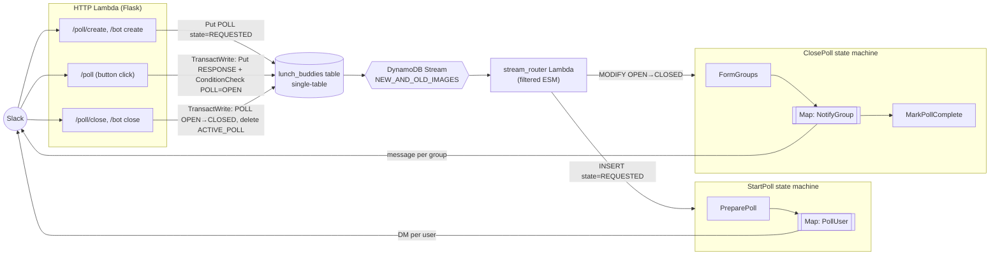

# Lunch Buddies backend: event-driven, single-table redesign

Status: **Draft for review**
Base commit: `2aa093f`

## 1. Goals

1. **The HTTP layer only writes state.** Each Slack request does a small number of DynamoDB reads/writes and returns right away. It never fans out and never calls Slack, except where it has to reply inline.
2. **One DynamoDB table** (single-table design) replaces the four tables `lunch_buddies_Team`, `_Poll`, `_PollResponse` and `_Group`.
3. **State changes drive the work.** A DynamoDB Streams consumer watches for poll state *transitions* and starts a Step Functions workflow for each one.
4. **Fan-out runs in Step Functions**, not by chaining SQS queues. There is one Lambda task per user (send the poll DM) and one per group (send the group message).
5. Fix the correctness gaps the current design can't handle well (see §2.2).

Non-goals for this phase: changing the poll UX, the grouping algorithm, invoicing logic, or the OAuth flow. Any of these can be layered on afterwards (see §9).

> Terminology: the request said "calls a dynamo for each user … the dynamo then sends the message". I've read that as **a Lambda** invocation per user. Correct me if you meant something else.

## 2. Current state (summary)

### 2.1 Flow today

```
Slack ──► Flask (Zappa Lambda) ──► SQS polls_to_start ──► create_poll  ──► SQS users_to_poll ──► poll_user ──► Slack DM
Slack ──► Flask: button click ───────────────────────────► PollResponse table
Slack ──► Flask ──► SQS polls_to_close ──► close_poll ──► SQS groups_to_notify ──► notify_group ──► Slack
```

- 4 SQS queues (+ `error`) per stage, wired to handlers in `zappa_settings.json`.
- 4 DynamoDB tables accessed through `dynamo_dao`.
- Runtime is `python3.8` on Zappa. Lambda has deprecated that runtime.

### 2.2 Problems this design fixes

| # | Problem | Where | How the new design fixes it |
|---|---------|-------|---------------------|
| P1 | **Race on "one active poll per channel"**: it's a read-then-write. Two concurrent creates both pass the check (the CHANGELOG 2020-02-25 entry describes the same class of issue). | `create_poll.py` | A conditional `ACTIVE_POLL` pointer item, written in a transaction (§4.3). |
| P2 | **Looking up a poll by `callback_id` reads every poll the team has ever made** and filters in Python. This runs on every button click, every user DM and every group notify, and gets slower as teams age. | `PollsDao.find_by_callback_id_or_die` | `PK = POLL#<callback_id>` → a single `GetItem`. |
| P3 | **Responses are accepted after a poll closes.** They're stored but never grouped. | `listen_to_poll.py` | The response write includes a `ConditionCheck` that the poll is `OPEN`. |
| P4 | **Non-idempotent retries.** If an SQS retry happens after a partial failure it can DM users twice, re-shuffle groups, or write a poll row and then fail (the CHANGELOG incident). | `create_poll`, `close_poll`, `notify_group` | Every workflow step is idempotent (§6). Groups are persisted *before* notifying. Deterministic execution names. |
| P5 | `time.sleep(1)` per DM as a crude rate limiter. | `poll_user.py` | Map `MaxConcurrency` + Retry with backoff on Slack `ratelimited`. |
| P6 | Slack Events API retries (`X-Slack-Retry-Num`) are not deduped. A slow bot response can create a second poll. | `bot_http` | Ignore retried deliveries, and the P1 fix makes duplicates harmless anyway. |
| P7 | Close errors ("No poll found", "already closed") come back as an async DM even though we know the answer synchronously. | `close_poll.py` | The close API resolves the poll inline and replies in the slash-command response. |

## 3. Target architecture



### 3.1 Components

| Component | Type | Responsibility |
|-----------|------|----------------|
| `http` | Lambda + API Gateway (Flask) | Validate Slack token and team, parse input, write a row, reply. |
| `stream_router` | Lambda, DynamoDB Streams event source mapping | Decode stream records, identify the state transition, `StartExecution` on the right state machine. No business logic. |
| `StartPoll` | Step Functions (Standard) | Resolve channel → validate → open poll → list members → Map over users. |
| `ClosePoll` | Step Functions (Standard) | Form and persist groups → Map over groups → mark complete. |
| `workflow_tasks` | Lambda (one function, several handlers, or one per task) | `PreparePoll`, `PollUser`, `FormGroups`, `NotifyGroup`, `NotifyFailure`. |
| `lunch_buddies` | DynamoDB table, on-demand, Streams on | All entities. |

**Why Standard rather than Express workflows:** Standard gives exactly-once execution semantics, durable execution history (good for debugging "why didn't I get a DM"), and name-based idempotency on `StartExecution`. At this traffic level the cost is negligible: each poll is about (users + groups) × ~4 state transitions, at $25 per million transitions.

**Why a Lambda router instead of EventBridge Pipes → SFN directly:** Pipes would remove a Lambda, but it can't set a deterministic execution name (needed for idempotency, §6). It would also put routing logic in infrastructure config, where it's harder to unit test. The router is about 50 lines. Pipes is listed as an alternative in §10.

## 4. Data model (single table)

Table `lunch_buddies` (dev: `dev_lunch_buddies`). Keys `PK` (S), `SK` (S). On-demand capacity. Stream `NEW_AND_OLD_IMAGES`. Point-in-time recovery on.
Every item carries `type` (entity name). Stream filters and analytics scripts use it.

### 4.1 Items

| Entity | PK | SK | GSI1PK | GSI1SK | Key attributes |
|--------|----|----|--------|--------|----------------|
| Team | `TEAM#<team_id>` | `TEAM` | `TEAMS` | `TEAM#<team_id>` | `bot_access_token`, `name`, `created_at`, `feature_notify_in_channel`, `stripe_customer_id`, `invoicing_enabled` |
| ActivePoll pointer | `TEAM#<team_id>` | `ACTIVE_POLL#<channel_id>` | – | – | `callback_id`, `created_at` |
| Poll | `POLL#<callback_id>` | `POLL` | `TEAM#<team_id>` | `POLL#<created_at_iso>` | `team_id`, `channel_id` (null until resolved), `created_by_user_id`, `state`, `choices` (list of maps), `group_size`, `requested_text`, `closed_by_user_id`, `closed_at`, `rejection_reason`, `stripe_invoice_id` |
| Recipient | `POLL#<callback_id>` | `RECIPIENT#<user_id>` | – | – | `sent_at`, `message_ts` |
| PollResponse | `POLL#<callback_id>` | `RESPONSE#<user_id>` | – | – | `response` (choice key), `created_at` |
| Group | `POLL#<callback_id>` | `GROUP#<response_key>#<nnn>` | – | – | `user_ids` (list), `response_key`, `notified_at` |

Notes:
- **Item collection per poll.** One `Query(PK=POLL#<id>)` returns the poll, recipients, responses and groups. That's exactly what `FormGroups`, `get_summary` and invoicing need.
- Timestamps become **ISO-8601 UTC strings**. Today they're naive local-time epoch decimals.
- `choices` becomes a native DynamoDB list of maps instead of a JSON string. The v1/v2 legacy choice formats get normalised once during backfill, so `choices_from_dynamo`'s compatibility branches can be deleted.
- `access_token` (already `"DEPRECATED"`) is dropped.
- GSI1 is overloaded: polls by team ordered by time, plus a sparse "all teams" partition for invoicing. The "all teams" partition is hot only during the monthly invoice job, which is fine at this scale.

### 4.2 Access patterns

| # | Pattern | Used by | Operation |
|---|---------|---------|-----------|
| A1 | Get team | every request | `GetItem TEAM#t / TEAM` |
| A2 | Get poll by callback_id | button click, PollUser, NotifyGroup | `GetItem POLL#c / POLL` |
| A3 | Get active poll for channel | close, create validation | `GetItem TEAM#t / ACTIVE_POLL#ch` |
| A4 | All active polls for team (slash close with no channel) | close | `Query TEAM#t, begins_with(SK, "ACTIVE_POLL#")` |
| A5 | Poll + responses + groups | FormGroups, summary, invoice | `Query POLL#c` (strongly consistent in FormGroups) |
| A6 | Polls for team since date | summary, invoice | `Query GSI1 TEAM#t, SK >= POLL#<iso>` |
| A7 | All teams | invoice | `Query GSI1 TEAMS` |

### 4.3 Poll state machine

```
            (API)                 (PreparePoll)             (API close)          (MarkPollComplete)
  ∅ ──► REQUESTED ──────────────► OPEN ────────────────────► CLOSED ────────────► COMPLETE
             │
             └──(PreparePoll)──► REJECTED   (no default channel / user not in channel / active poll exists)
```

- `REQUESTED → OPEN` is one `TransactWriteItems`:
  - `Update POLL` set `state=OPEN, channel_id=…`, condition `state = REQUESTED`.
  - `Put ACTIVE_POLL#<channel>` with condition `attribute_not_exists(PK) OR created_at < :24h_ago`. This keeps today's rule that an open poll older than one day no longer blocks a new one.

  If the pointer condition fails, `PreparePoll` sets the poll to `REJECTED` and DMs "There is already an active poll". **This fixes P1.**
- `OPEN → CLOSED` (API) is one transaction: update the poll with condition `state = OPEN`, and delete the `ACTIVE_POLL` pointer with condition `callback_id = :c`.
- `CLOSED → COMPLETE` is the final state of `ClosePoll`. It's optional, but it makes stuck polls easy to find.

The router only acts on two transitions, **INSERT with `state=REQUESTED`** and **MODIFY with `OldImage.state=OPEN` and `NewImage.state=CLOSED`**. As a result:
- Backfilled items, which are inserted as `OPEN`, `CLOSED` or `COMPLETE`, never trigger workflows (important for §8).
- Writes of responses, recipients and groups, and the `REQUESTED→OPEN` and `CLOSED→COMPLETE` updates, never trigger workflows.

Both conditions go into the **event source mapping filter criteria**, so Lambda isn't even invoked for other records. The router re-checks them in code as a safety net.

## 5. Flows in detail

### 5.1 Create poll

**HTTP (`/api/v0/poll/create` and `@Lunch Buddies create`):**
1. Validate the token and team (A1).
2. Handle `help`. Parse the text with `parse_message_text`; on `InvalidPollOption`/`InvalidPollSize`, reply `Failed: …` inline (unchanged).
3. `PutItem` the Poll with `state=REQUESTED`, a new `callback_id`, `channel_id` (null for the slash command), parsed `choices` and `group_size`, condition `attribute_not_exists(PK)`.
4. Reply `ok!`.

**Router:** `StartExecution(StartPoll, name="start-<callback_id>", input={callback_id})`.

**StartPoll state machine:**

```
PreparePoll (Lambda)
  ├─ load poll + team
  ├─ channel_id ?? resolve default #lunch_buddies (DM error + REJECTED if missing / user not a member)
  ├─ TransactWrite REQUESTED→OPEN + ACTIVE_POLL pointer   (REJECTED + DM on conflict)
  ├─ conversations_members(channel)  → BatchWrite RECIPIENT#<user> items (idempotent puts)
  └─ return { callback_id, user_ids: [...] }
Choice: user_ids empty? → Succeed
Map (ItemsPath $.user_ids, MaxConcurrency 5)
  └─ PollUser (Lambda) { callback_id, user_id }
        Retry: SlackRateLimited (backoff from Retry-After), States.TaskFailed ×3 exp backoff
        Catch → record failure, continue (one bad user must not fail the poll)
Catch-all on PreparePoll → NotifyFailure (DM creator "something went wrong") → Fail
```

**PollUser:** `GetItem` poll; skip unless `OPEN`. Skip if `RECIPIENT.sent_at` is already set. Post the DM, which is the same payload as today's `poll_user`. Then `Update RECIPIENT` set `sent_at`, `message_ts`.

Map size: inline Map is limited by the 25k-event execution history, about 3,000 users per poll. That's far above realistic channel sizes. If we ever need more, switch to a Distributed Map that reads the recipient list from S3, with no Lambda code changes.

### 5.2 Respond to poll (button click)

**HTTP (`/api/v0/poll`):** This is the only flow that stays fully synchronous, because Slack expects the updated message in the response.
1. `GetItem` poll (A2) to resolve the choice's display text.
2. `TransactWriteItems`:
   - `ConditionCheck POLL` `state = OPEN`
   - `Put RESPONSE#<user_id>` (last write wins, same as today)
3. Return the original message with the "✅ Your answer of `…` was received!" attachment. If the condition failed, return "This poll has already closed" instead. **This fixes P3.**

No stream action (filtered out).

### 5.3 Close poll

**HTTP (`/api/v0/poll/close` and `@Lunch Buddies close`):**
1. Validate the token and team. Handle `help`.
2. Resolve the target poll:
   - With a channel (bot mention): use `ACTIVE_POLL#<channel>` (A3).
   - Slash command (no channel): use A4. If there's exactly one active poll for the team, use it. If there are several, fall back to today's default-channel lookup via Slack. If there are none, reply "No poll found". *(Open question Q5.)*
3. Transaction `OPEN → CLOSED` (§4.3), setting `closed_by_user_id` and `closed_at`. If the condition fails, reply "already closed".
4. Reply `ok!`. "No poll found" and "already closed" now come back **inline** instead of as a DM (P7).

**Router:** `StartExecution(ClosePoll, name="close-<callback_id>", input={callback_id})`.

**ClosePoll state machine:**

```
FormGroups (Lambda)
  ├─ strongly-consistent Query POLL#c  (poll, responses, existing groups)
  ├─ if GROUP# items already exist → return them           (idempotent retry; no re-shuffle)
  ├─ no yes-responses → DM closer "No poll responses found" → return []
  ├─ _group_by_answer + _get_groups (unchanged algorithm)
  ├─ BatchWrite GROUP#<key>#<nnn> items
  └─ return { callback_id, group_sks: [...] }
Map (ItemsPath $.group_sks, MaxConcurrency 5)
  └─ NotifyGroup (Lambda) { callback_id, group_sk }
        skip if notified_at set; notify (in-channel or private, unchanged logic); set notified_at
        Retry as above
MarkPollComplete (native DynamoDB UpdateItem task, no Lambda): CLOSED → COMPLETE
```

The strongly consistent read happens after the `OPEN → CLOSED` commit, and every response write is conditioned on `OPEN`. So `FormGroups` is guaranteed to see the final set of responses.

### 5.4 Unchanged or lightly touched

| Endpoint | Change |
|----------|--------|
| `/help`, `/install` | none |
| `/auth` (OAuth) | Swap the DAO to the Team item. Stays synchronous for now. |
| `/bot` `summary` | Reads via A6 + A5 instead of full-table polls/groups reads. |
| `/bot` | Ignore requests carrying `X-Slack-Retry-Num` (P6). |
| `/error` | Remove (it tests the SQS error queue, which goes away). Replace with a test that triggers a Sentry error directly if still wanted. |
| `invoice` | Swap to A7 + A6 + A5. Logic unchanged. |
| `scripts/*` | `close_all_polls_for_team`: becomes a loop of the close transaction. `save_to_sql` / `analysis`: read the new table by `type`. |

## 6. Idempotency and failure handling

| Layer | Mechanism |
|-------|-----------|
| HTTP create | `attribute_not_exists` on a fresh UUID, plus the `ACTIVE_POLL` condition downstream. Retried bot events are ignored. |
| Stream → router | ESM with `MaximumRetryAttempts=5`, `BisectBatchOnFunctionError`, `FunctionResponseTypes=[ReportBatchItemFailures]`, on-failure destination SQS DLQ. |
| Router → SFN | Deterministic execution names (`start-<id>`, `close-<id>`). A duplicate stream delivery gets either the running execution or `ExecutionAlreadyExists`, and the router treats both as success. |
| PreparePoll | Conditional transitions. Recipient puts are idempotent. A re-run after `OPEN` skips straight to listing recipients. |
| PollUser / NotifyGroup | `sent_at` / `notified_at` markers. A crash *between* the Slack post and writing the marker can still produce one duplicate message. That's an accepted at-least-once edge, and it's much narrower than today. |
| FormGroups | Persisted groups are the source of truth. A retry reuses them instead of re-shuffling. |
| Observability | `sentry-sdk` (replaces the deprecated `raven`) in all Lambdas. An EventBridge rule on SFN `FAILED`/`TIMED_OUT` → SNS/email. CloudWatch alarm on the DLQ depth. |

## 7. Code structure

```
src/lunch_buddies/
  app/
    http.py               # Flask routes: thin, write-only
    stream_router.py      # DynamoDB stream → StartExecution
    workflow_tasks.py     # Lambda entrypoints: prepare_poll, poll_user, form_groups, notify_group, notify_failure
  domain/                 # pure, no I/O. Moved from actions/ with no logic changes
    poll_text.py          # parse_message_text, get_choice_from_raw_option, ...
    grouping.py           # _group_by_answer, _get_groups
    messages.py           # Slack message/attachment builders
  repository/
    table.py              # boto3 Table wrapper, key builders, (de)serialisation
    teams.py polls.py responses.py groups.py recipients.py
  services/               # orchestration used by http + workflow_tasks
    create_poll.py respond.py close_poll.py start_poll_steps.py close_poll_steps.py summary.py invoice.py oauth2.py
  clients/slack.py stripe.py http.py   # sqs_v2.py deleted
infra/                    # IaC (see Q2)
  statemachines/start_poll.asl.json close_poll.asl.json
scripts/migrate_to_single_table.py
```

Removed: `clients/sqs_v2.py`, `actions/queue_*.py`, `app/handlers.py`, `dao/*`, the `dynamo_dao` dependency, the SQS queues, and `zappa_settings.json` (depending on Q2).

**Testing:**
- Unit tests for `domain/`. Existing tests port almost unchanged.
- `moto` for repository tests, including transactions and condition failures.
- Router tests that feed recorded stream events.
- Task-handler tests with a fake Slack client.
- CI validates the ASL files (`aws stepfunctions validate-state-machine-definition`, or with the CDK synth).
- One end-to-end smoke test in dev after deploy.

## 8. Migration and cutover

The app is low-traffic and lunchtime-bound, so a **short off-hours cutover** is simpler and safer than dual-writes.

1. **Deploy the new stack alongside the old one** (new table, streams, router, state machines, task Lambdas). Nothing points at it yet.
2. **Backfill script** (`scripts/migrate_to_single_table.py`):
   - Scan the 4 old tables → transform → `PutItem` with `attribute_not_exists` so it never clobbers newer data. Re-runnable. `--dry-run` prints counts and diffs.
   - Poll state mapping: `CREATED` → `OPEN`, and `CLOSED` → `COMPLETE` if it has groups, `CLOSED` otherwise.
   - Create `ACTIVE_POLL` pointers for `OPEN` polls created in the last 24h, so they can still be closed after cutover.
   - Because nothing is inserted as `REQUESTED` and nothing goes through a `OPEN→CLOSED` MODIFY, **the backfill triggers no workflows.**
   - Verification: per-team counts of polls, responses and groups match the old tables.
3. **Dev rehearsal:** run steps 1–2 plus the cutover against `dev_*` and do a full create → respond → close cycle.
4. **Prod cutover (evening PT):**
   1. Confirm the SQS queues are drained.
   2. Run the backfill.
   3. Deploy the HTTP Lambda pointing at the new table.
   4. Re-run the backfill to catch responses written in between.
   5. Smoke test.
5. **Decommission** after ~2 weeks: remove the SQS event sources and queues, keep the old tables as a backup (PITR export), then delete them.

**Rollback:** redeploy the previous HTTP build, which still points at the old tables. Anything created during the window would need a reverse copy, which is acceptable given the short window.

## 9. Implementation plan (PR-sized steps)

| # | PR | Contents | Risk |
|---|----|----------|------|
| 1 | Platform upgrade | Python 3.12, `sentry-sdk`, IaC skeleton (Q2), CI on the new toolchain. No behaviour change. | Low |
| 2 | Extract `domain/` | Move pure logic out of `actions/` (parsing, grouping, message builders). Tests ported. No behaviour change. | Low |
| 3 | Single-table repository | `repository/` + table definition in IaC + moto tests. Not wired in. | Low |
| 4 | Backfill script | Plus a verification report. Run against dev. | Low |
| 5 | Workflows | Task Lambdas, ASL definitions, router, ESM filters, DLQ, alarms. Deployed to dev, idle. | Med |
| 6 | HTTP rewrite | Endpoints write-only against the new table. `summary`, `invoice`, `oauth2` and scripts moved to the repository. Dev end-to-end. | Med |
| 7 | Prod cutover | Runbook from §8. | Med |
| 8 | Cleanup | Delete SQS code and queues, `dao/`, `dynamo_dao`, Zappa config (if applicable). Update README and diagrams. | Low |

PRs 1–4 can merge independently with no user-visible effect. The behaviour switch happens only at 6–7.

## 10. Alternatives considered

- **Keep SQS, only move to single table.** Smaller change, but it keeps the queue-chaining design and doesn't fix P4/P5 as cleanly. It also doesn't match the "write a row, react to the row" model you want.
- **EventBridge Pipes (Stream → SFN) instead of the router Lambda.** Fewer moving parts, but no deterministic execution names, and routing lives in config. Worth revisiting if the router stays trivial.
- **Do channel resolution and the active-poll check synchronously in the API.** Better UX (errors inline), but the slash-command path needs Slack `conversations.list` pagination inside the 3s budget, and it goes against the "API only writes" goal. The bot-mention path *could* do it sync since the channel is known. I've kept both async for uniformity (Q4).
- **Step Functions HTTP Task calling Slack directly (no per-user Lambda).** Not viable: the bot token is per-team, and connections take static auth.

## 11. Open questions for you

1. **"Dynamo per user"**: confirm that this means one Lambda task per user and per group.
2. **IaC / deploy tool.** Zappa can't define streams, ESM filters or state machines. Options:
   - (a) **AWS CDK in Python** for everything. This is my recommendation: same language as the app, and it handles ASL, IAM and ESM filters well.
   - (b) AWS SAM.
   - (c) Terraform.
   - (d) Keep Zappa for the Flask app plus a separate stack for the rest.
3. **API Gateway URL.** Moving off Zappa changes the `execute-api` URL configured in the Slack app (slash commands, interactivity, events, OAuth redirect) and in the README install link. Are you OK updating the Slack app config? A custom domain would avoid this in the future.
4. **Validation placement for create**: async in `PreparePoll` (proposed) vs sync in the API for bot mentions?
5. **Slash-command close with no channel**: OK to use "the team's only active poll" before falling back to the default-channel Slack lookup?
6. **Other readers of the old tables.** Does `lunch-buddies-web`, or anything else, read `lunch_buddies_*` directly?
7. **Scope.** OK to leave OAuth and invoicing synchronous and logically unchanged for this refactor (only swapping storage)?
8. **Closed-poll responses.** Is it OK to start rejecting button clicks after close with a "poll closed" reply (P3)?
