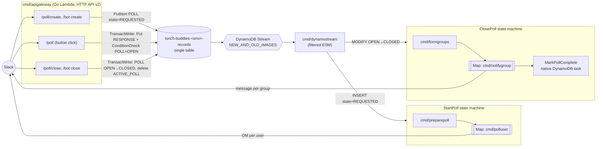

# Lunch Buddies backend: event-driven, single-table rewrite in Go

Status: **Draft for review** (rev 2: rewritten for Go, following `qsweber/go-template`)
Base commit: `2aa093f` · Template reference: `qsweber/go-template@8ad5afe`

## 1. Goals

1. **Rewrite the backend in Go**, following the patterns in [`go-template`](https://github.com/qsweber/go-template). Flask, Zappa and the Python codebase are retired.
2. **The HTTP layer only writes state.** Each Slack request does a small number of DynamoDB reads/writes and returns right away. It never fans out and never calls Slack, except where it has to reply inline.
3. **One DynamoDB table** (single-table design, template conventions) replaces `lunch_buddies_Team`, `_Poll`, `_PollResponse` and `_Group`.
4. **State changes drive the work.** A DynamoDB Streams consumer watches for poll state *transitions* and starts a Step Functions workflow for each one.
5. **Fan-out runs in Step Functions**, not by chaining SQS queues. There is one Lambda task per user (send the poll DM) and one per group (send the group message).
6. Fix the correctness gaps the current design can't handle well (see §2.2).

Non-goals: changing the poll UX, the grouping algorithm, invoicing logic or the OAuth flow. They are **ported as-is**; behaviour parity is the bar for the Go port.

> Terminology: the original request said "calls a dynamo for each user … the dynamo then sends the message". I've read that as **a Lambda** invocation per user.

## 2. Current state (summary)

### 2.1 Flow today

```
Slack ──► Flask (Zappa Lambda) ──► SQS polls_to_start ──► create_poll  ──► SQS users_to_poll ──► poll_user ──► Slack DM
Slack ──► Flask: button click ───────────────────────────► PollResponse table
Slack ──► Flask ──► SQS polls_to_close ──► close_poll ──► SQS groups_to_notify ──► notify_group ──► Slack
```

- Python 3.8 (a deprecated Lambda runtime) on Zappa. The API is at an `execute-api` URL that is configured in the Slack app.
- 4 SQS queues (+ `error`) per stage, wired up in `zappa_settings.json`.
- 4 DynamoDB tables accessed through `dynamo_dao`.

### 2.2 Problems this design fixes

| # | Problem | Where (Python today) | How the new design fixes it |
|---|---------|----------------------|---------------------|
| P1 | **Race on "one active poll per channel"**: it's a read-then-write. Two concurrent creates both pass the check (the CHANGELOG 2020-02-25 entry describes the same class of issue). | `create_poll.py` | A conditional `ACTIVE_POLL` pointer item, written in a transaction (§4.3). |
| P2 | **Looking up a poll by `callback_id` reads every poll the team has ever made** and filters in memory. This runs on every button click, every DM and every group notify. | `PollsDao.find_by_callback_id_or_die` | `pk = POLL#<callback_id>` → a single `GetItem`. |
| P3 | **Responses are accepted after a poll closes.** They're stored but never grouped. | `listen_to_poll.py` | The response write includes a `ConditionCheck` that the poll is `OPEN`. |
| P4 | **Non-idempotent retries.** If an SQS retry happens after a partial failure it can DM users twice, re-shuffle groups, or write a poll row and then fail. | `create_poll`, `close_poll`, `notify_group` | Every workflow step is idempotent (§6). Groups are persisted *before* notifying. Deterministic execution names. |
| P5 | `time.sleep(1)` per DM as a crude rate limiter. | `poll_user.py` | Map `MaxConcurrency` + Retry with backoff on Slack `ratelimited`. |
| P6 | Slack Events API retries (`X-Slack-Retry-Num`) are not deduped. A slow bot response can create a second poll. | `bot_http` | Ignore retried deliveries, and the P1 fix makes duplicates harmless anyway. |
| P7 | Close errors ("No poll found", "already closed") come back as an async DM even though we know the answer synchronously. | `close_poll.py` | The close API resolves the poll inline and replies in the slash-command response. |
| P8 | The API URL is a raw `execute-api` hostname, so changing the infrastructure means reconfiguring the Slack app. | Zappa | A custom domain on the HTTP API (template `cdk/domain.go`). This is the last time the Slack URLs change. |

## 3. Target architecture



### 3.1 Components (template-aligned)

Each Lambda is its own `cmd/<name>/main.go`, built to a `bootstrap` binary and zipped by a Makefile target, as in the template.

| Lambda (`cmd/…`) | Trigger | Responsibility |
|------------------|---------|----------------|
| `apigateway` | HTTP API v2, `$default` route (template `cdk/apigateway.go`) | Adapts the event to `server.Request`. `internal/server` routes it, verifies the Slack request, parses the form/JSON body, writes rows and replies. |
| `dynamostream` | DynamoDB stream ESM with filter criteria (template `cdk/stream.go`) | Identifies the poll state transition and calls `StartExecution`. No business logic. |
| `preparepoll` | StartPoll SFN task | Resolve channel, validate, `REQUESTED→OPEN`, list members, write recipients. |
| `polluser` | StartPoll Map task | Send one poll DM. |
| `formgroups` | ClosePoll SFN task | Read responses, form and persist groups. |
| `notifygroup` | ClosePoll Map task | Send one group message. |
| `notifyfailure` | SFN `Catch` target | DM the poll creator or closer that something went wrong. |
| `invoice` | Manual invoke, or an EventBridge schedule (Q6) | Port of `actions/invoice.py`. |

Infrastructure is CDK in Go under `cdk/`. It uses the template's L1 `Cfn*` style, inline IAM policies on `CfnRole`, `s3assets` for the zips, `dev`/`prod` stacks via `EnvConfig`, and a custom domain. State machines are `awsstepfunctions.CfnStateMachine`, loaded from `cdk/statemachines/*.asl.json` with `DefinitionSubstitutions` for the Lambda ARNs.

Template pieces that **don't apply**: Cognito and its PostConfirmation trigger, and SES. Slack has its own auth (see §5.0).

**Why Standard rather than Express workflows:** Standard gives exactly-once execution semantics, durable execution history (good for debugging "why didn't I get a DM"), and name-based idempotency on `StartExecution`. At this traffic level the cost is negligible.

**Why a router Lambda instead of EventBridge Pipes → SFN directly:** Pipes can't set a deterministic execution name (needed for idempotency, §6). It would also move routing into config, where it's harder to test. The router is tiny and matches the template's `cmd/dynamostream`.

## 4. Data model (single table)

Following the template: the table is `lunch-buddies-<env>-records`, with string `pk` and string `sk`, on-demand capacity. **Entities are distinguished by key shape**; there is no separate `type` attribute. Timestamps are `int64` Unix milliseconds (`created_at`, etc.).

Deviations from the template, both needed:
- The stream view type is **`NEW_AND_OLD_IMAGES`**, not `NEW_IMAGE`. The close transition is detected via `OldImage.state`.
- **One GSI** (`gsi1`: `gsi1pk`/`gsi1sk`).

Point-in-time recovery is on.

### 4.1 Items

| Entity | pk | sk | gsi1pk | gsi1sk | Other attributes |
|--------|----|----|--------|--------|------------------|
| Team | `TEAM#<team_id>` | `TEAM` | `TEAMS` | `TEAM#<team_id>` | `bot_access_token`, `name`, `created_at`, `feature_notify_in_channel`, `stripe_customer_id`, `invoicing_enabled` |
| ActivePoll pointer | `TEAM#<team_id>` | `ACTIVE_POLL#<channel_id>` | – | – | `callback_id`, `created_at` |
| Poll | `POLL#<callback_id>` | `POLL` | `TEAM#<team_id>` | `POLL#<created_at, zero-padded>` | `team_id`, `channel_id` (empty until resolved), `created_by_user_id`, `state`, `choices` (list of maps), `group_size`, `requested_text`, `closed_by_user_id`, `closed_at`, `rejection_reason`, `stripe_invoice_id` |
| Recipient | `POLL#<callback_id>` | `RECIPIENT#<user_id>` | – | – | `sent_at`, `message_ts` |
| PollResponse | `POLL#<callback_id>` | `RESPONSE#<user_id>` | – | – | `response` (choice key), `created_at` |
| Group | `POLL#<callback_id>` | `GROUP#<response_key>#<nnn>` | – | – | `user_ids` (list), `response_key`, `notified_at` |

Notes:
- **Item collection per poll.** One `Query(pk=POLL#<id>)` returns the poll, recipients, responses and groups. That's exactly what `formgroups`, `summary` and `invoice` need.
- `choices` becomes a native list of maps. The legacy v1/v2 JSON formats (`choices_from_dynamo`) are normalised once by the migration tool, so the Go code supports only the current shape.
- `access_token` (already `"DEPRECATED"`) is dropped.
- GSI1 is overloaded: polls by team ordered by time, plus a sparse "all teams" partition for invoicing.

### 4.2 Access patterns

| # | Pattern | Used by | Operation |
|---|---------|---------|-----------|
| A1 | Get team | every request | `GetItem TEAM#t / TEAM` |
| A2 | Get poll by callback_id | button click, polluser, notifygroup | `GetItem POLL#c / POLL` |
| A3 | Get active poll for channel | close, preparepoll | `GetItem TEAM#t / ACTIVE_POLL#ch` |
| A4 | All active polls for team (slash close with no channel) | close | `Query TEAM#t, begins_with(sk, "ACTIVE_POLL#")` |
| A5 | Poll + responses + groups | formgroups, summary, invoice | `Query POLL#c` (strongly consistent in formgroups) |
| A6 | Polls for team since date | summary, invoice | `Query gsi1 TEAM#t, gsi1sk >= POLL#<ms>` |
| A7 | All teams | invoice | `Query gsi1 TEAMS` |

### 4.3 Poll state machine

```
            (API)                 (preparepoll)             (API close)          (MarkPollComplete)
  ∅ ──► REQUESTED ──────────────► OPEN ────────────────────► CLOSED ────────────► COMPLETE
             │
             └──(preparepoll)──► REJECTED   (no default channel / user not in channel / active poll exists)
```

- `REQUESTED → OPEN` is one `TransactWriteItems`:
  - Update the poll to `state=OPEN, channel_id=…`, condition `state = REQUESTED`.
  - Put `ACTIVE_POLL#<channel>`, condition `attribute_not_exists(pk) OR created_at < :24h_ago`. This keeps today's rule that an open poll older than one day no longer blocks a new one.

  If the pointer condition fails, the poll becomes `REJECTED` and the creator gets "There is already an active poll". **This fixes P1.**
- `OPEN → CLOSED` (API) is one transaction: update the poll with condition `state = OPEN`, and delete the pointer with condition `callback_id = :c`.
- `CLOSED → COMPLETE` is the final step of ClosePoll. It makes stuck polls easy to find.

The router acts on exactly two transitions. Both are expressed as **ESM filter criteria** (template style, keyed on `sk`), so the Lambda isn't invoked for anything else:

```json
{"eventName":["INSERT"],"dynamodb":{"NewImage":{"sk":{"S":["POLL"]},"state":{"S":["REQUESTED"]}}}}
{"eventName":["MODIFY"],"dynamodb":{"OldImage":{"state":{"S":["OPEN"]}},"NewImage":{"sk":{"S":["POLL"]},"state":{"S":["CLOSED"]}}}}
```

The router re-checks the conditions in code as a safety net. As a result, migrated items, which are inserted as `OPEN`, `CLOSED` or `COMPLETE`, and every other write, never trigger workflows (important for §8).

## 5. Flows in detail

### 5.0 HTTP handling in Go

- `cmd/apigateway` adapts `events.APIGatewayV2HTTPRequest` → `server.Request`, the same as the template. It must also handle `IsBase64Encoded`, since Slack bodies are form-encoded.
- `internal/server.Handle` does a `switch` on path. The existing paths are kept (`/api/v0/poll/create`, `/api/v0/poll`, `/api/v0/poll/close`, `/api/v0/help`, `/api/v0/install`, `/api/v0/auth`, `/api/v0/bot`) so the Slack app config only changes host, not paths. `/api/v0/ping` is added for the deploy smoke test, as in the template's CI.
- **Slack request verification** replaces the template's Cognito check. Recommendation (Q4): verify the `X-Slack-Signature` HMAC with the signing secret over the raw body, which the adapter already has. During the transition we can also accept the legacy `token` field, matching today's `VERIFICATION_TOKEN` / `VERIFICATION_TOKEN_DEV`.
- Slash command and interactivity bodies are parsed with `url.ParseQuery`. The interactivity `payload` field and Events API bodies are JSON-decoded into typed structs.
- Secrets (signing secret, OAuth client id/secret, Stripe key) come from env vars set by CDK, sourced from SSM Parameter Store or Secrets Manager rather than committed config (Q5).

### 5.1 Create poll

**HTTP (`/api/v0/poll/create` and `@Lunch Buddies create`):**
1. Verify the request and the team (A1).
2. Handle `help`. Parse the text (port of `parse_message_text`); on an invalid option or size, reply `Failed: …` inline (unchanged).
3. `PutItem` the Poll with `state=REQUESTED`, a new `callback_id` (UUIDv4), `channel_id` (empty for the slash command), `choices` and `group_size`, condition `attribute_not_exists(pk)`.
4. Reply `ok!`.

**Router:** `StartExecution(StartPoll, name="start-<callback_id>", input={"callback_id": …})`.

**StartPoll state machine:**

```
preparepoll
  ├─ load poll + team
  ├─ channel_id empty → resolve default #lunch_buddies (DM error + REJECTED if missing / user not a member)
  ├─ TransactWrite REQUESTED→OPEN + ACTIVE_POLL pointer   (REJECTED + DM on conflict)
  ├─ conversations.members(channel)  → BatchWrite RECIPIENT#<user> items (idempotent puts)
  └─ return { callback_id, user_ids: [...] }
Choice: user_ids empty? → Succeed
Map (ItemsPath $.user_ids, MaxConcurrency 5)
  └─ polluser { callback_id, user_id }
        Retry: SlackRateLimited (backoff), States.TaskFailed ×3 exp backoff
        Catch → continue (one bad user must not fail the poll)
Catch-all on preparepoll → notifyfailure → Fail
```

**polluser:** `GetItem` the poll; skip unless `OPEN`. Skip if the recipient's `sent_at` is already set. Post the DM, which is the same message and buttons as today. Then set `sent_at` and `message_ts`.

Inline Map is limited by the 25k-event execution history, roughly 3,000 users per poll. If we ever need more, switch to a Distributed Map that reads from S3, with no Lambda changes.

### 5.2 Respond to poll (button click)

**HTTP (`/api/v0/poll`):** This is the only flow that stays fully synchronous, because Slack expects the updated message in the response.
1. `GetItem` poll (A2) to resolve the choice's display text.
2. `TransactWriteItems`: `ConditionCheck` that the poll's `state = OPEN`, plus `Put RESPONSE#<user_id>` (last write wins).
3. Return the original message plus the "✅ Your answer of `…` was received!" attachment. If the condition failed, return "This poll has already closed" instead (P3).

No stream action.

### 5.3 Close poll

**HTTP (`/api/v0/poll/close` and `@Lunch Buddies close`):**
1. Verify the request and the team. Handle `help`.
2. Resolve the target poll:
   - With a channel (bot mention): A3.
   - Slash command: A4. If the team has exactly one active poll, use it. If there are several, fall back to the default-channel lookup via Slack. If there are none, reply "No poll found".
3. Transaction `OPEN → CLOSED` (§4.3), setting `closed_by_user_id` and `closed_at`. If the condition fails, reply "already closed".
4. Reply `ok!`. "No poll found" and "already closed" now come back **inline** (P7).

**Router:** `StartExecution(ClosePoll, name="close-<callback_id>", ...)`.

**ClosePoll state machine:**

```
formgroups
  ├─ strongly-consistent Query POLL#c  (poll, responses, existing groups)
  ├─ GROUP# items already exist → return them           (idempotent retry; no re-shuffle)
  ├─ no yes-responses → DM closer "No poll responses found" → return []
  ├─ group by answer + getGroups (straight port of the Python algorithm)
  ├─ BatchWrite GROUP#<key>#<nnn> items
  └─ return { callback_id, group_sks: [...] }
Map (ItemsPath $.group_sks, MaxConcurrency 5)
  └─ notifygroup { callback_id, group_sk }
        skip if notified_at set; in-channel or private notify (unchanged logic); set notified_at
MarkPollComplete (native arn:aws:states:::dynamodb:updateItem task): CLOSED → COMPLETE
```

The strongly consistent read happens after the close commits, and every response write is conditioned on `OPEN`. So `formgroups` always sees the final set of responses.

### 5.4 Other endpoints (ported, storage swapped)

| Endpoint | Go port notes |
|----------|---------------|
| `/help`, `/install` | Trivial. |
| `/auth` (OAuth) | Synchronous as today. Calls `oauth.v2.access`, upserts the Team item, creates/updates the Stripe customer, sends the welcome DM. |
| `/bot` | Ignore requests carrying `X-Slack-Retry-Num` (P6). Also answer the Events API `url_verification` challenge. `create`, `close` and `help` share code with the slash commands. |
| `/bot` `summary` | A6 + A5. Formats times in the user's tz (`time.LoadLocation`). |
| `/error` | Dropped. |
| `invoice` | `cmd/invoice`: A7 + A6 + A5, Stripe via `stripe-go`. Logic unchanged. |
| `scripts/*` | `close_all_polls_for_team` → a small `cmd/tools` subcommand. `save_to_sql` / `analysis` are retired, or rewritten later if still used (Q7). |

## 6. Idempotency and failure handling

| Layer | Mechanism |
|-------|-----------|
| HTTP create | `attribute_not_exists` on a fresh UUID, plus the `ACTIVE_POLL` condition downstream. Retried bot events are ignored. |
| Stream → router | ESM `MaximumRetryAttempts=5`, `BisectBatchOnFunctionError`, `FunctionResponseTypes=[ReportBatchItemFailures]` (`events.DynamoDBEventResponse`), on-failure destination SQS DLQ. |
| Router → SFN | Deterministic execution names (`start-<id>`, `close-<id>`). `ExecutionAlreadyExists` is treated as success. |
| preparepoll | Conditional transitions. Recipient puts are idempotent. A re-run after `OPEN` skips straight to listing recipients. |
| polluser / notifygroup | `sent_at` / `notified_at` markers. A crash between the Slack post and writing the marker can still produce one duplicate message. That's an accepted at-least-once edge. |
| formgroups | Persisted groups are the source of truth. A retry reuses them instead of re-shuffling. |
| Observability | Structured logs (`log/slog`) to CloudWatch. An EventBridge rule on SFN `FAILED`/`TIMED_OUT` → SNS email. Alarms on DLQ depth and Lambda errors. Sentry (`sentry-go`) is optional (Q5). |

## 7. Code structure (mirrors go-template)

```
go.mod                          # module github.com/qsweber/lunch-buddies, go 1.25.x
Makefile                        # build-<lambda>-lambda targets → <lambda>.zip; test (go test -race ./...)
cmd/
  apigateway/main.go            # template adapter, unchanged in shape
  dynamostream/main.go          # router: transition → StartExecution
  preparepoll/ polluser/ formgroups/ notifygroup/ notifyfailure/ invoice/  main.go each
  migrate/main.go               # one-off old-tables → new-table backfill (§8)
internal/
  server/                       # Handle() router + one file per endpoint, ServiceContext (template pattern)
  slackverify/                  # signing-secret / token verification (replaces internal/auth)
  repositories/                 # main.go (DynamoDBAPI interface, key consts), teams.go, polls.go,
                                #   responses.go, groups.go, recipients.go
  workflows/                    # task logic shared by the cmd/* task Lambdas; StepFunctionsAPI interface
  polls/                        # pure domain: parse.go (poll text), grouping.go, messages.go
  clients/slack/                # SlackAPI interface + impl (slack-go/slack)
  clients/stripe/               # StripeAPI interface + impl (stripe-go)
cdk/
  main.go stack.go iam.go dynamo.go stream.go apigateway.go domain.go   # adapted from template
  stepfunctions.go workflows.go alarms.go                                # new
  statemachines/start_poll.asl.json close_poll.asl.json
docs/
  design/event-driven-single-table.md
  request-lifecycle.md          # sequence diagrams per flow, like the template's
.github/workflows/ci.yml pr.yml production.yml                         # template: PR → dev, main → prod, OIDC
```

Conventions carried over from the template:
- **Repositories**: an interface plus an `…Impl` per entity, built with `(tableName, DynamoDBAPI)`, using `attributevalue` struct tags. They return `nil, nil` for not found, and swallow `ConditionalCheckFailedException` where the operation is idempotent. Cross-entity transactions (`OpenPoll`, `ClosePoll`, `RecordResponse`) live on `PollsRepository`. `DynamoDBAPI` grows to include `Query`, `TransactWriteItems` and `BatchWriteItem`.
- **ServiceContext** is built once per cold start (`NewServiceContext`, env `RECORDS_TABLE` plus the state machine ARNs and secrets) and injected into `server.New` and the task handlers.
- **External clients sit behind small interfaces** (`SlackAPI`, `StripeAPI`, `StepFunctionsAPI`, `DynamoDBAPI`), so tests use hand-written fakes. There's no moto or localstack.
- **Randomness is injectable** (`*rand.Rand` in `polls.GetGroups` and in picking who chooses the location), so grouping tests are deterministic.
- **Tests**: table-driven `_test.go` next to the code, `go test -race ./...`, `gofmt` and `go vet` gates in CI, and `cdk synth --all` in CI. The Python tests in `tests/actions/test_create_poll.py` and `test_close_poll.py` become the **parity spec** for `internal/polls`. Port their cases one-to-one.
- **IAM**: inline policies on `CfnRole`, scoped per role:
  - API role: `GetItem`, `PutItem`, `UpdateItem`, `DeleteItem`, `ConditionCheckItem`, `Query` on the table and index.
  - Router role: `states:StartExecution`.
  - Task role: those DynamoDB actions plus `BatchWriteItem`.
  - SFN role: `lambda:InvokeFunction` and `dynamodb:UpdateItem`.

## 8. Migration and cutover

The Go stack is **entirely new infrastructure** (new table, HTTP API, custom domain). Nothing is imported from the Zappa CloudFormation stack. This gives a clean switch: **the cutover is changing the Slack app's request URLs** to the new custom domain. Until then the old Python stack keeps serving traffic.

1. **Deploy the new stack** (dev via PR, prod via `main`, as in the template's CI). It's idle because Slack doesn't point at it yet.
2. **`cmd/migrate`** (run locally with AWS credentials):
   - Scan the 4 old tables → transform → `PutItem` with `attribute_not_exists(pk)` so it never clobbers newer data. Re-runnable. `-dry-run` prints counts.
   - Normalise the legacy `choices` formats. Convert timestamps to Unix ms.
   - Poll state mapping: `CREATED` → `OPEN`, and `CLOSED` → `COMPLETE` if it has groups, `CLOSED` otherwise.
   - Create `ACTIVE_POLL` pointers for `OPEN` polls created in the last 24h.
   - Because of the filters in §4.3, **migration triggers no workflows.**
   - Verification: per-team counts of polls, responses and groups.
3. **Dev rehearsal:** point the dev Slack app at the dev stack's domain and run a full create → respond → close cycle.
4. **Prod cutover (evening PT):**
   1. Run `migrate`.
   2. Switch the Slack app URLs (slash commands, interactivity, events, OAuth redirect) to the new domain.
   3. Confirm the old SQS queues are drained.
   4. Re-run `migrate` to pick up stragglers.
   5. Smoke test.
5. **Rollback:** point the Slack URLs back at the old `execute-api` URL. Data written in the window needs a reverse copy, which is acceptable given the short window.
6. **Decommission** after ~2 weeks:
   - `zappa undeploy` (removes the old Lambda, API and SQS mappings), then delete the queues.
   - Export the old tables (PITR), then delete them.
   - Remove `src/`, `tests/`, `setup.py`, `tox.ini`, `requirements*.txt`, `zappa_settings.json` and the old workflow.

## 9. Implementation plan (PR-sized steps)

| # | PR | Contents | Risk |
|---|----|----------|------|
| 1 | Scaffold from go-template | `go.mod`, Makefile, `cmd/apigateway` with `/api/v0/ping`, `internal/server` skeleton. CDK stack with table (+gsi1, `NEW_AND_OLD_IMAGES`, PITR), HTTP API and custom domain. Cognito and SES removed. CI workflows (OIDC role, PR → dev, push → prod). Python stays in place and untouched. | Low |
| 2 | Domain port | `internal/polls`: text parsing, grouping, message builders, with tests ported from the Python suite for parity. | Low |
| 3 | Repositories | All entities + transactions + fakes + tests. | Low |
| 4 | Clients + verification | `SlackAPI`, `StripeAPI` interfaces/impls, `slackverify`. | Low |
| 5 | Workflows | Task Lambdas, ASL, router, ESM filters, DLQ, alarms, IAM. Deployed to dev, idle. | Med |
| 6 | HTTP endpoints | create/respond/close/help/install/auth/bot/summary. Dev Slack app pointed at dev stack; end-to-end test. | Med |
| 7 | Invoice + tools | `cmd/invoice`, `cmd/tools close-all-polls`. | Low |
| 8 | Migration tool | `cmd/migrate` + dry-run against prod (read-only) and a real run against dev. | Med |
| 9 | Prod cutover | Runbook from §8. Docs: `request-lifecycle.md`, README. | Med |
| 10 | Decommission | Remove Python/Zappa, old queues and tables. | Low |

PRs 1–8 deploy alongside the running Python app with no user-visible effect. The behaviour switch happens only at step 9, and it's reversible by flipping the Slack URLs back.

## 10. Alternatives considered

- **Keep Python, only move to single table + SFN.** This was rev 1 of this doc. Superseded by the decision to standardise on go-template.
- **New repository generated from go-template** instead of rewriting in place. It would give a cleaner history, but loses issues, PR history and the README badge/install link continuity. See Q1.
- **EventBridge Pipes (Stream → SFN) instead of the router Lambda.** It has no deterministic execution names, and routing would live in config.
- **Synchronous channel resolution and active-poll check in the API.** Better UX, but the slash-command path needs Slack `conversations.list` pagination inside the 3s budget. It also goes against "API only writes".
- **Step Functions HTTP Task calling Slack directly.** Not viable: the bot token is per-team, and connections take static auth.

## 11. Open questions

1. **Repo layout.** Rewrite in place in `qsweber/lunch-buddies` (recommended: Go at the root next to the Python until decommission), or a fresh repo from the template? Also, go-template deploys prod on `main` but this repo's default branch is `master`. Should we rename it to `main`?
2. **Custom domain.** Which hostname: `api.lunchbuddiesapp.com` (if that zone is in Route 53 in this account) or e.g. `lunch-buddies-api.quinnweber.com` (the template's zone)? Same question for dev.
3. **Dev Slack app.** I'm assuming the dev app behind `VERIFICATION_TOKEN_DEV` still exists and can be pointed at the dev stack.
4. **Request verification.** Switch to signing-secret HMAC (recommended; Slack has deprecated verification tokens), keeping the legacy token as a fallback during the transition?
5. **Secrets and errors.** SSM Parameter Store vs Secrets Manager for the Slack and Stripe secrets? Keep Sentry (`sentry-go`), or rely on CloudWatch alarms like the template?
6. **Invoicing.** It isn't scheduled in Zappa today. Should `cmd/invoice` stay manual-invoke or get a monthly EventBridge schedule?
7. **Scripts.** Are `save_to_sql.py` / `analysis.py` still used? Does `lunch-buddies-web` read the old tables directly?
8. **Slash-command close with no channel.** OK to use "the team's only active poll" before falling back to the default-channel Slack lookup?
9. **Closed-poll responses.** OK to start rejecting clicks after close with a "poll closed" reply (P3)?
